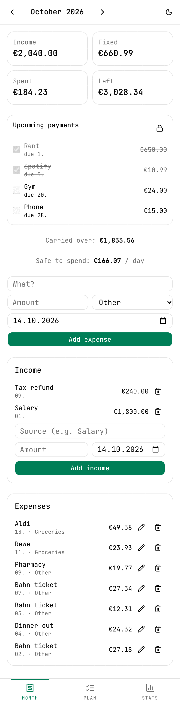
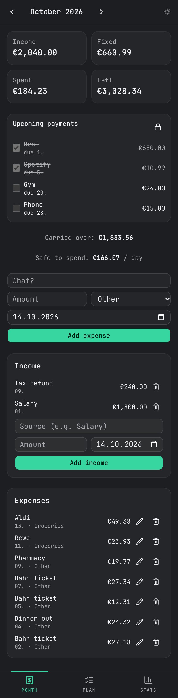
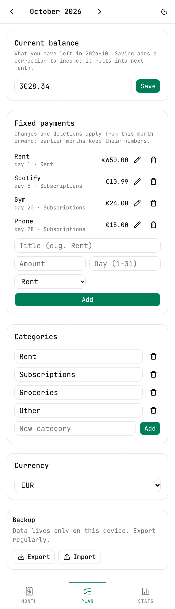
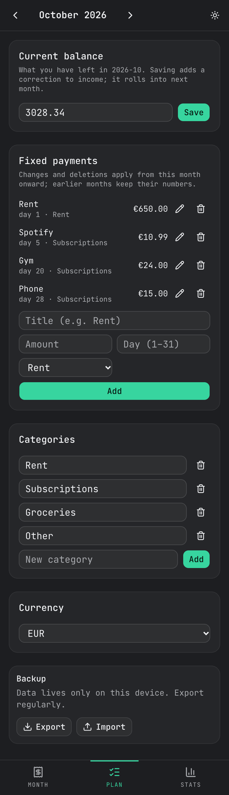
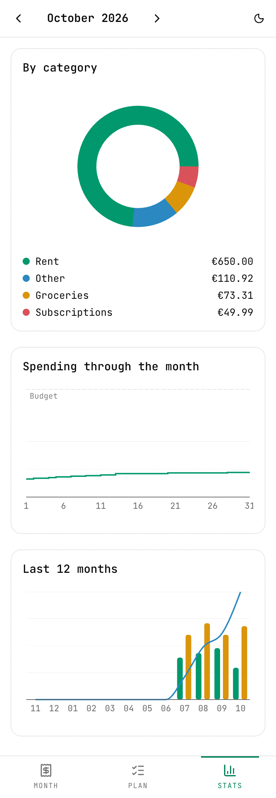
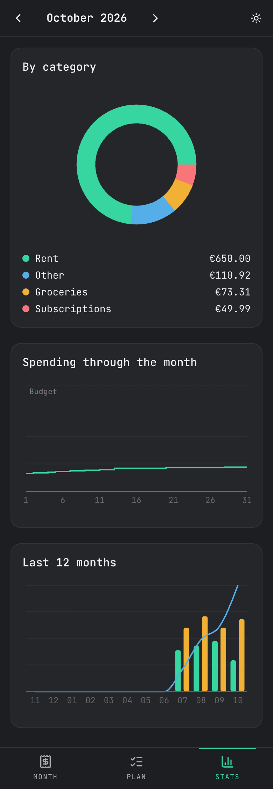

<div align="center">


# VielGeld

**A minimal budget app for one person.**
Log money coming in, tick off fixed payments as they happen, track spending by category, and watch your balance roll from month to month.

Installable PWA · works offline · no account · no backend · your data never leaves your device

<br />


&nbsp;&nbsp;


</div>

---

## Why

Most budget apps want a bank connection, an account and a subscription. VielGeld wants none of that. You tell it what you have, what came in and what you spent, and it answers one question: **how much can I spend today without running out before the month does?**

Nothing is deducted behind your back. A salary is not "credited" on the 1st and a rent payment is not "taken" until its day has actually come (or you say it has).

## Features

### Balance and income
- **Current balance:** type what you actually have and VielGeld logs the difference as a correction, so history stays intact.
- **Income is dated, not recurring.** Salary, freelance work, a tax refund: add each when the money really arrives.
- **Rollover:** whatever is left at the end of a month carries into the next one (an overspend carries too). Future months project forward using your fixed payments.

### Fixed payments you confirm
- Rent, subscriptions, phone: set them up once with a due day. Each shows in an **Upcoming payments** card on the home page.
- A payment is **struck through and counted automatically once its due day passes**. Day 31 clamps to the last day of shorter months.
- Paid early? Tick it by hand. The checkboxes sit behind a **lock** that you must open first and that re-locks after every tick, so you can't tick one by accident.
- Changing or deleting a fixed payment applies from the selected month onward; earlier months keep their numbers.

### Spending
- Quick expense logging: title, amount, category, date. Edit or delete any entry.
- **Safe to spend per day**: your remaining balance, minus payments still to come, divided by the days left in the month.
- Categories you can rename and add to.

### Stats
- Category breakdown for the month (donut).
- Cumulative spending through the month against your budget.
- Last 12 months: spent, income and end-of-month balance.

### Everything else
- Light and dark theme, following your system or toggled from the header.
- Swipe left and right to move between tabs; arrows to change month.
- Any currency; amounts use your browser's number format.
- **Export / Import** the whole database as JSON (with a confirm step before a restore). This is the only way to move data between devices, as there is no sync.
- Installs to your home screen and works offline.

## Screenshots

| | Light | Dark |
|---|:---:|:---:|
| **Month**<br/>balance, upcoming payments, income and expenses |  |  |
| **Plan**<br/>current balance, fixed payments, categories, currency, backup |  |  |
| **Stats**<br/>category split, daily spending, 12-month history |  |  |

*Screenshots use made-up demo data.*

## Tech stack

| | |
|---|---|
| Framework | [Next.js 16](https://nextjs.org) (App Router, static export) · React 19 |
| Storage | [Dexie](https://dexie.org) over IndexedDB, read reactively with `useLiveQuery` |
| UI | [shadcn/ui](https://ui.shadcn.com) (`base-nova`, Base UI primitives) · Tailwind CSS 4 · JetBrains Mono |
| Charts | [Recharts](https://recharts.org) |
| Theming | `next-themes` (class-based dark mode) |
| PWA | hand-written service worker and web manifest |

## Getting started

```bash
pnpm install
pnpm dev            # http://localhost:3000 (service worker is not registered in dev)
```

```bash
pnpm build          # static export to out/ (also type-checks)
npx serve out       # preview the production build; needed to test PWA / offline
pnpm lint
node --test lib/    # unit tests (Node strips TS types natively, no runner to install)
```

Add a shadcn component with `pnpm dlx shadcn@latest add <name>`.

## Deploying

The app is a fully static export (`output: "export"`), so any static host works. On [Vercel](https://vercel.com/new), import the repo; the Next.js preset needs no configuration.

Because data lives in each browser's IndexedDB, a new URL starts empty. Use **Plan → Backup → Export** on the old one and **Import** on the new one to move over.

## How it works

```
app/
  page.tsx          Month: summary tiles, upcoming payments, income, expenses
  plan/page.tsx     Balance, fixed payments, categories, currency, backup
  stats/page.tsx    Charts
components/
  shell.tsx         header, month arrows, bottom tabs, swipe navigation
  backup.tsx        JSON export / import
lib/
  db.ts             Dexie schema (categories, fixed, expenses, income, settings)
  budget.ts         pure logic: summarize, carryOver, isPaid, month helpers
  hooks.ts          useMonth (?m=YYYY-MM) and useMonthData (live query)
  money.ts          toCents / fmt, the only place money is converted
public/
  sw.js             network-first service worker, manifest, icons
```

A few decisions worth knowing:

- **Money is integer cents** in storage and logic; conversion happens only at input (`toCents`) and display (`fmt`).
- **The selected month lives in the URL** (`?m=2026-10`), so nav links, back button and reloads all agree.
- **The balance is computed, never stored.** `carryOver` sums every earlier month's income minus fixed payments minus expenses, starting at the first month with real data.
- **History is per month.** A fixed payment is active from `from` through an optional `until`; editing one ends the old entry and starts a new one, so past months are never rewritten.
- **`lib/budget.ts` has no React or Dexie imports**, which is what lets `node --test` run it directly.

More detail for contributors (and for AI coding agents) is in [`CLAUDE.md`](CLAUDE.md).

## Data and privacy

Everything is stored locally in your browser. There are no analytics, no network calls for your data and no accounts. Clearing site data deletes your budget, so export a backup now and then.
